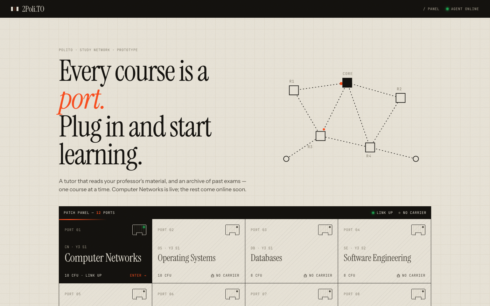
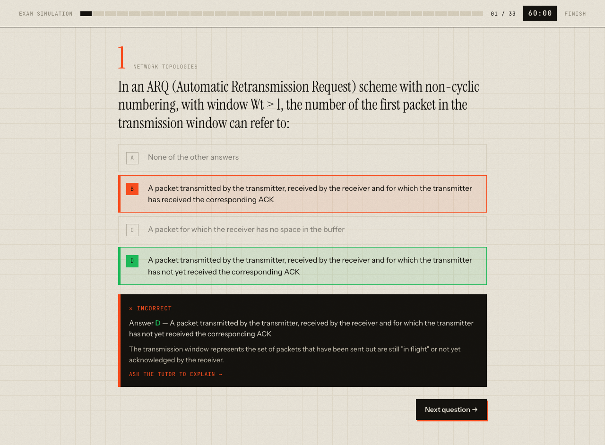
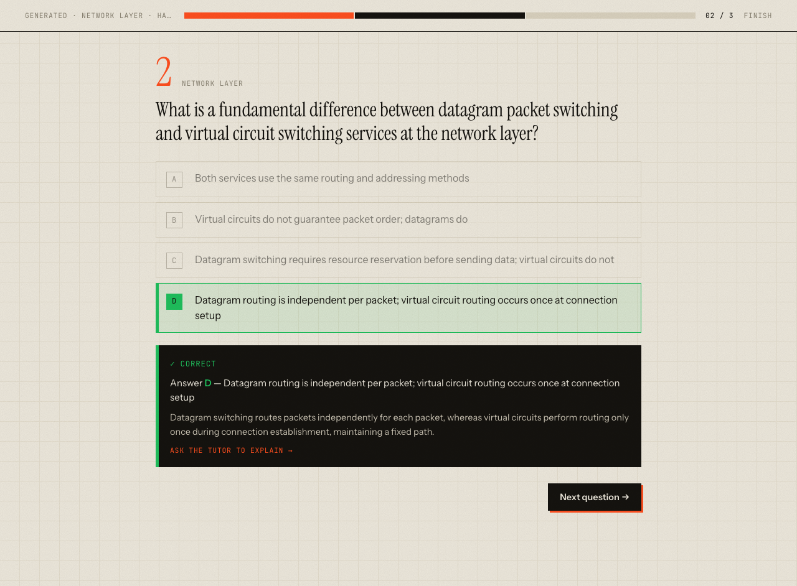
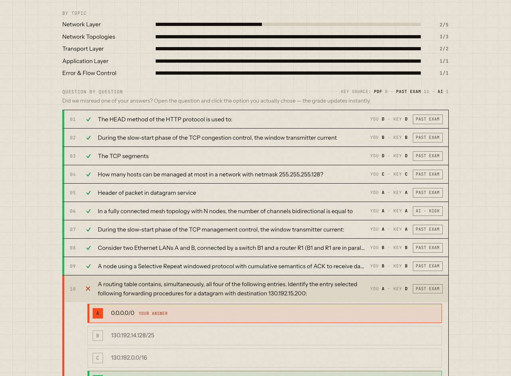
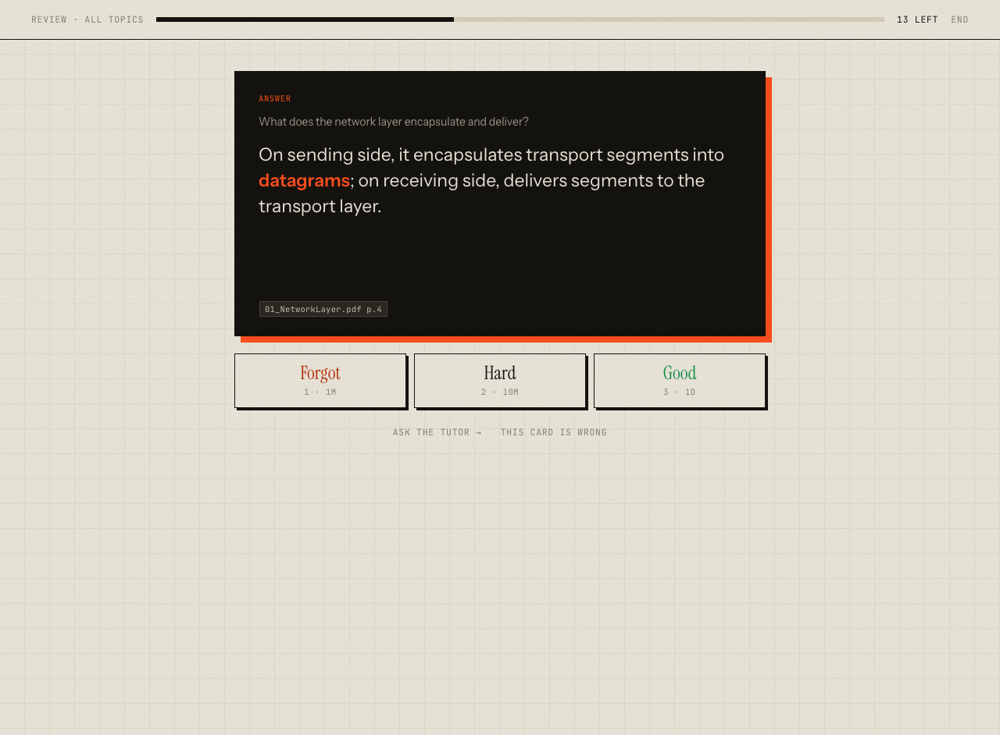

# 2Poli.TO

**Every course is a port. Plug in and start learning.**

A study portal for Politecnico di Torino courses: an AI tutor that answers from your professor’s material, the past exam questions, a generator for new ones, an exam analyzer that estimates your grade out of 30, and spaced-repetition flashcards. All in one place, per course.

### ▶ Live demo: [yusuf.gultekin.me/2polito](https://yusuf.gultekin.me/2polito/)

The demo is a static version: past questions, flashcards and an example generated set work in the browser; the Tutor, question generation and exam analysis are shown but need the server version below with your own API key.

> Prototype. **Computer Networks** is the live course; the other courses are on the panel, locked until their material is added.
> Not affiliated with Politecnico di Torino.

[](https://yusuf.gultekin.me/2polito/)

---

## What’s inside

| | Tool | What it does |
|---|---|---|
| 01 | **Tutor** | Chat agent grounded in the course material. It searches the slides only when it needs to and cites every claim as `[file p.N]`. English or Italian. |
| 02 | **Past questions** | 315 real exam questions in 11 topics. Exam simulation (33 questions, 60 minutes), topic practice and a mistake log you re-test until it’s empty. |
| 03 | **Question forge** | Generates new exam-style questions for a topic, using past questions as style references and the slides as ground truth. |
| 04 | **Exam analysis** | Upload the PDF the exam platform gives you (or photos of the screen) and get an estimated grade out of 30, question by question. |
| 05 | **Flashcards** | 259 short recall cards with spaced repetition. Topics you got wrong elsewhere come first. |

The tools feed each other: wrong answers in practice or in a real exam mark their topic as weak, flashcards for weak topics come first, and every question, card and result has an **ask the tutor** button.

<table>
  <tr>
    <td width="50%"><br><sub><b>Past questions:</b> exam simulation with timer, feedback and explanation</sub></td>
    <td width="50%"><br><sub><b>Question forge:</b> a generated network-layer question</sub></td>
  </tr>
  <tr>
    <td width="50%"><br><sub><b>Exam analysis:</b> your answer, the key, and where the key came from</sub></td>
    <td width="50%"><br><sub><b>Flashcards:</b> Forgot / Hard / Good, with the next interval shown</sub></td>
  </tr>
</table>

---

## Quick start

Requirements: **Node.js 20+** and an **OpenAI API key**.

```bash
git clone <repo-url> 2polito && cd 2polito
npm install
cp .env.example .env        # paste your OPENAI_API_KEY
npm start                   # → http://localhost:3000
```

Past questions and flashcards work right away, without an API key: the repo ships with a ready-made deck of 259 cards.

For the Tutor, Question forge and Exam analysis, **add the course material**: put the slides in `materials/computer-networks/` (PDF, MD or TXT), or drag and drop them into the portal’s sidebar. They are indexed on start. See [`materials/README.md`](materials/README.md).

> The professors’ material is **not** in this repository and never should be. The past questions are; they come from [Portale dei Quiz](https://yusuf.gultekin.me/portale/).

### Configuration

| Variable | Default | Used for |
|---|---|---|
| `OPENAI_API_KEY` | — | Required for all AI features |
| `OPENAI_MODEL` | `gpt-4.1-mini` | Tutor, Question forge |
| `OPENAI_ANALYSIS_MODEL` | `gpt-4.1` | Exam analysis (reads PDFs and photos; a stronger model is more reliable) |
| `OPENAI_FLASHCARD_MODEL` | `OPENAI_MODEL` | Building the flashcard deck |
| `OPENAI_EMBED_MODEL` | `text-embedding-3-small` | Indexing the course material |
| `PORT` | `3000` | HTTP port |

---

## How it works

### Tutor: retrieval-augmented chat
1. **Index once.** Every file in `materials/<course>/` is split into page-level chunks and embedded. Vectors are cached in `.cache/` keyed by file hash, so restarting or adding one file never re-embeds the rest.
2. **Decide.** The agent has one tool, `search_course_materials`. It decides whether it needs the material and what to search for, and can search more than once.
3. **Search.** Cosine similarity on embeddings plus a small boost for exact terms (acronyms like `OSPF` or `TCP Reno` matter).
4. **Answer.** The reply streams over SSE with `[file p.N]` citations; hovering a source shows the excerpt.

### Exam analysis: building the answer key
The grade is only as good as the key, so each question’s key comes from the first source that has it:

1. **Official.** The correct answer, if the PDF shows it.
2. **Past exam.** A matching question in the 315-question bank.
3. **Solved.** Solved from the course material with a confidence level; uncertain keys turn the grade into a range.

Then the grade is computed in the browser with your rule (default: +1 correct, 0 wrong, 0 blank, capped at 30), so you can change the rule or fix a misread answer and the grade updates instantly. On a controlled 12-question test exam the result was exact on two separate runs.

### Question forge and flashcards
Both use structured outputs. The forge makes the model solve each question in a hidden scratch field *before* it commits to an answer, then shuffles the options. The flashcard deck is generated once per course into `data/flashcards/<course>.json` (the Computer Networks deck is included), so everyone studies the same cards and wrong ones can be fixed by hand. Cards students report land in `data/flashcards/<course>.flags.json`; **rebuild** at the bottom of the Flashcards tab regenerates the deck.

Progress (mistakes, flashcard schedule, past analyses, chat history) stays in the browser’s `localStorage`.

---

## Project structure

```
├── server.js                 Express server and API
├── lib/
│   ├── indexer.js            PDF/MD/TXT → chunks → embeddings (+ disk cache), hybrid search
│   ├── agent.js              Tutor: tool-calling loop with streaming
│   ├── generator.js          Question forge
│   ├── analyzer.js           Exam analysis: extraction → key → report
│   └── flashcards.js         Flashcard deck builder
├── public/                   Front end, plain HTML/CSS/JS (no build step)
│   ├── index.html · styles.css · app.js
│   ├── quiz.js               Past questions + forge runner
│   ├── analysis.js           Exam analysis UI
│   └── flashcards.js         Spaced repetition
├── data/
│   ├── courses.json          Courses on the panel (set "unlocked": true to open one)
│   ├── exams/<course>.json   Past exam questions
│   └── flashcards/<course>.json  Flashcard deck
├── materials/<course>/       Course material (git-ignored)
└── docs/screenshots/
```

### Past question format

`data/exams/<course>.json`:

```json
{
  "simulation": { "questions": 33, "minutes": 60 },
  "topics": [{ "id": "transport-layer", "label": "Transport Layer" }],
  "questions": [
    {
      "id": "cn-001",
      "topic": "transport-layer",
      "text": "The congestion window at the beginning of a TCP connection…",
      "options": ["…", "…", "…"],
      "answer": 0,
      "hint": "Why the answer is correct."
    }
  ]
}
```

`answer` is the 0-based index of the correct option.

### Adding a course

1. Set `"unlocked": true` for the course in `data/courses.json`.
2. Add its past questions as `data/exams/<course-id>.json`.
3. Put its material in `materials/<course-id>/` and restart.

<details>
<summary><b>API</b></summary>

| Method | Path | |
|---|---|---|
| `GET` | `/api/courses` | Courses and server status |
| `GET` | `/api/courses/:id/exams` | Past questions |
| `GET` · `POST` | `/api/courses/:id/materials` | Indexed files · upload files |
| `POST` | `/api/courses/:id/reindex` | Rebuild the index |
| `POST` | `/api/courses/:id/chat` | Tutor (SSE stream) |
| `POST` | `/api/courses/:id/generate` | Question forge |
| `POST` | `/api/courses/:id/analyze` | Exam analysis (multipart, SSE stream) |
| `GET` | `/api/courses/:id/flashcards` | Flashcard deck |
| `POST` | `/api/courses/:id/flashcards/build` | Build the deck (SSE stream) |
| `POST` | `/api/courses/:id/flashcards/flag` | Report a wrong card |

</details>

---

## Notes

- **AI output can be wrong.** Generated questions, flashcards and analysis keys are checked against the material and past exams, but treat the grade as an estimate and report wrong cards.
- **Costs.** Everything runs on your own OpenAI key. Indexing is paid once per file; exam analysis uses the larger model and costs more for long photo PDFs. Set `OPENAI_ANALYSIS_MODEL=gpt-4.1-mini` to save.
- **Material and copyright.** Only add material you are allowed to use; keep it out of git (the `.gitignore` already does).

## Roadmap

- [ ] Unlock more courses
- [ ] Tune exam analysis on real exports from the PoliTo exam platform
- [ ] Curate the flashcard deck from student reports
- [ ] Hosting and student accounts

## License

The **source code** is released under the [MIT License](LICENSE) © 2026 Yasir Yusuf Gultekin.

The **past exam questions** (`data/exams/`) and the **flashcards** (`data/flashcards/`) are derived from Politecnico di Torino course exams and course material. All rights remain with their respective authors. They are shared for study purposes only and are **not** covered by the MIT License. If you are a rights holder and want something removed, please open an issue and it will be taken down.
